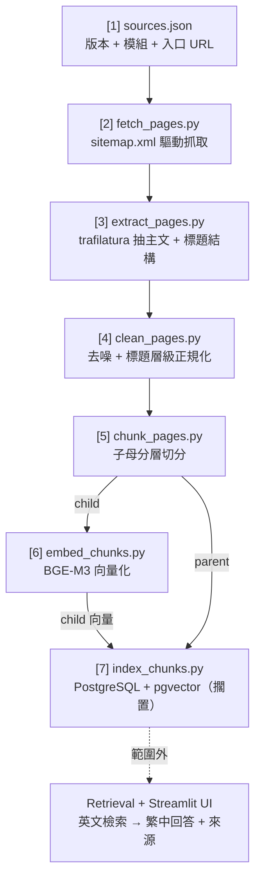

# Minecraft AE2 RAG Assistant

針對 Minecraft 1.21.1 與 Applied Energistics 2（AE2）的知識問答 RAG 助手：只依據 AE2 官方 1.21.1 指南回答，每個答案附可點擊的來源連結；官方文件不足以回答時，明確回覆「目前官方文件不足以確認」，不猜測、不補完。

本專案同時是**學習成熟 RAG 技術棧**的練習：各階段採用業界常見的工具與做法（trafilatura、langchain-text-splitters、子母分層切分、BGE-M3、pgvector）。

## 核心原則

1. **來源限定**：只使用 `guide.appliedenergistics.org` 的 1.21.1 官方頁面。
2. **答案附來源**：每個回答標註出自哪個頁面與章節。
3. **不足則明說**：檢索不到依據時，回答「目前官方文件不足以確認」。

## 文件導覽

| 文件 | 內容 |
| --- | --- |
| `README.md`（本文件） | 專案介紹、安裝與執行、開發狀態 |
| [`ARCHITECTURE.md`](ARCHITECTURE.md) | 各模塊架構圖（§2）與目標契約（§5：輸入、輸出、欄位、規則） |
| [`docs/adr/`](docs/adr/) | 架構決策紀錄：為什麼這樣設計、否決了哪些方案 |
| [`AGENTS.md`](AGENTS.md) | AI Agent 在本專案工作的規則與驗收標準 |

## 架構總覽



每個階段讀上游產物、寫自己的輸出，可以單獨重跑；所有中間產物都是單次記錄、整份覆寫。資料一律依 `<version>/<mod_slug>/<chapter>/` 分層。

- 各模塊的「輸入 > 處理 > 輸出」與範例：[`ARCHITECTURE.md`](ARCHITECTURE.md) §2
- 正式契約（欄位、規則、失敗處理）：[`ARCHITECTURE.md`](ARCHITECTURE.md) §5

## 使用方式

### 安裝

建議以虛擬環境安裝（Python 3.12）：

```bash
python -m venv .venv
```

```bash
.venv\Scripts\activate
```

**有 NVIDIA GPU 時**：Windows 上 PyPI 的 `torch` 是 CPU-only build，須先從 PyTorch 的 cu130 index 安裝 GPU 版，再裝其餘依賴（torch 是 sentence-transformers 的傳遞依賴，不寫進 `requirements.txt`）：

```bash
pip install torch==2.14.0 --index-url https://download.pytorch.org/whl/cu130
```

```bash
pip install -r requirements.txt
```

沒有 GPU 時，直接執行 `pip install -r requirements.txt` 即可。

### 執行 pipeline

```bash
python src/fetch_pages.py
```

```bash
python src/extract_pages.py
```

```bash
python src/clean_pages.py
```

| 指令 | 階段 | 輸出 |
| --- | --- | --- |
| `src/fetch_pages.py` | [2] 由 sitemap.xml 抓取所有 1.21.1 頁面 | `data/raw/` |
| `src/extract_pages.py` | [3] 抽取主文與標題結構 | `data/processed/extracted/`、`reports/extraction_report.md` |
| `src/clean_pages.py` | [4] 清理 | `data/processed/cleaned/`、`reports/cleaning_report.md` |
| `src/chunk_pages.py` | [5] 切分（尚未實作） | `data/processed/chunks/` |
| `src/embed_chunks.py` | [6] 向量化（尚未實作） | `data/processed/embeddings/` |

- [2] 失敗的頁面不會重試，會記錄在 `_manifest.json`；人工查驗後重新執行即可。
- [6] 使用的 BGE-M3 模型約 2.3 GB，首次執行時才會從 Hugging Face 下載，建議使用 GPU。
- [7] 入庫目前擱置。

### 金鑰

LLM 的 API key 一律透過 `.env` 讀取（範本見 `.env.example`），不得寫入程式碼或版控。

## 開發狀態

最後更新：2026-10-22。實際狀態以程式碼與 Git 為準。

| 階段 | 狀態 |
| --- | --- |
| [1] 入口 | 完成：`sources.json` 新格式 |
| [2] 抓取 | 已實作：sitemap.xml 真值來源，1.21.1 共 124 頁 |
| [3] 抽取 | 已實作：121 頁輸出（3 頁導覽索引跳過）；含標題結構（`markdown` 欄位） |
| [4] 清理 | 已實作：119 頁輸出（2 頁跳轉頁跳過）；含標題層級正規化，69 頁帶章節標題 |
| [5] 切分 | 待實作：框架與大小上限已定（子母分層；parent ≤ 1024、child ≤ 256） |
| [6] Embedding | 待實作：框架已定（BGE-M3，1024 維） |
| [7] 入庫 | 擱置：schema 待 [1]–[6] 跑通後定義 |

## 安全須知

- `.env`、`gcm-diagnose.log` 等敏感檔案已列入 `.gitignore`。請勿直接壓縮分享整個專案資料夾，改用 Git clone 或明確挑選檔案。
- 若曾在本機產生含 API key 的診斷檔，該 key 應視為已外洩，請至 provider 端輪換。
