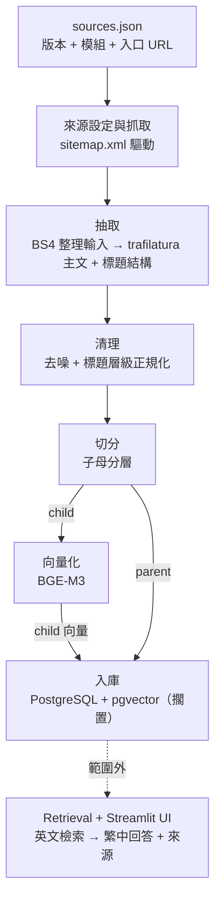

# Minecraft AE2 RAG Assistant

針對 Minecraft 1.21.1 與 Applied Energistics 2（AE2）的知識問答 RAG 助手：只依據 AE2 官方 1.21.1 指南回答，每個答案附可點擊的來源連結；官方文件不足以回答時，明確回覆「目前官方文件不足以確認」，不猜測、不補完。

本專案同時是**學習成熟 RAG 技術棧**的練習：各階段採用業界常見的工具與做法（trafilatura、langchain-text-splitters、子母分層切分、BGE-M3、pgvector）。

## 核心原則

1. **來源限定**：只使用 `guide.appliedenergistics.org` 的 1.21.1 官方頁面。
2. **答案附來源**：每個回答標註出自哪個頁面與章節。
3. **不足則明說**：檢索不到依據時，回答「目前官方文件不足以確認」。

## 文件導覽

| 文件 | 內容 |
| --- | --- |
| `README.md`（本文件） | 專案介紹、安裝與執行、專案狀態 |
| [`ARCHITECTURE.md`](ARCHITECTURE.md) | 架構地圖：模塊有哪些、怎麼串接、邊界與不變式 |
| [`docs/01_fetch.md`](docs/01_fetch.md) | 來源設定與抓取 |
| [`docs/02_extract.md`](docs/02_extract.md) | 抽取 |
| [`docs/03_clean.md`](docs/03_clean.md) | 清理 |
| [`docs/04_chunk.md`](docs/04_chunk.md) | 切分 |
| [`docs/05_embed.md`](docs/05_embed.md) | 向量化 |
| [`docs/06_index.md`](docs/06_index.md) | 入庫 |
| [`docs/07_troubleshooting.md`](docs/07_troubleshooting.md) | 疑難排解 |
| [`AGENTS.md`](AGENTS.md) | AI Agent 在本專案工作的規則與驗收標準 |

每份模塊文件都包含：輸入與輸出、處理方法、為什麼這樣做、否決的方案、驗證方式、待定事項。

## 架構總覽



每個模塊讀上游產物、寫自己的輸出，可以單獨重跑；所有中間產物都是單次記錄、整份覆寫。模塊地圖、邊界與不變式見 [`ARCHITECTURE.md`](ARCHITECTURE.md)；各模塊的細節見 `docs/`。

## 使用方式

### 安裝

建議以虛擬環境安裝（Python 3.12）：

```bash
python -m venv .venv
```

Windows：

```bash
.venv\Scripts\activate
```

macOS／Linux：

```bash
source .venv/bin/activate
```

**有 NVIDIA GPU 時**：Windows 上 PyPI 的 `torch` 是 CPU-only build，須先從 PyTorch 的 cu130 index 安裝 GPU 版，再裝其餘依賴（torch 是 sentence-transformers 的傳遞依賴，不寫進 `requirements.txt`）：

```bash
pip install torch==2.14.0 --index-url https://download.pytorch.org/whl/cu130
```

```bash
pip install -r requirements.txt
```

沒有 GPU 時，直接執行 `pip install -r requirements.txt` 即可（可跑 [2]–[5] 與 [6] 的 `--dry-run`；[6] 實際向量化需要 GPU）。

### 執行 pipeline

```bash
python src/fetch_pages.py
```

```bash
python src/extract_pages.py
```

```bash
python src/clean_pages.py
```

```bash
python src/chunk_pages.py
```

| 指令 | 模塊 | 輸出 |
| --- | --- | --- |
| `src/fetch_pages.py` | 來源設定與抓取 | `data/raw/` |
| `src/extract_pages.py` | 抽取 | `data/processed/extracted/`、`reports/extraction_report.md` |
| `src/clean_pages.py` | 清理 | `data/processed/cleaned/`、`reports/cleaning_report.md` |
| `src/chunk_pages.py` | 切分 | `data/processed/chunks/`、`reports/chunking_report.md` |
| `src/embed_chunks.py` | 向量化 | `data/processed/embeddings/` |

- 抓取失敗的頁面不會重試，會記錄在 `_manifest.json`；人工查驗後重新執行即可。
- 切分首次執行時會從 Hugging Face 下載 BGE-M3 的 tokenizer 檔（不含模型權重）。
- 向量化使用的 BGE-M3 模型約 2.3 GB，首次執行時才會從 Hugging Face 下載；向量化需要 NVIDIA GPU。
- 入庫目前擱置。

### 金鑰

LLM 的 API key 一律透過 `.env` 讀取（範本見 `.env.example`），不得寫入程式碼或版控。

## 專案狀態

> 開發期間暫時保留，專案完成後移除。最後更新：2026-10-29；實際狀態以程式碼與 Git 為準。

| 模塊 | 狀態 |
| --- | --- |
| 來源設定與抓取 | 已實作：1.21.1 共 124 頁 |
| 抽取 | 已實作：119 頁輸出（5 頁跳過：3 個導覽頁、2 個已確認的跳轉頁）；含標題結構與配方 |
| 清理 | 已實作：119 頁輸出（0 頁跳過）；69 頁帶章節標題、85 頁附配方 |
| 切分 | 已實作：119 頁 → parent 387 個、child 466 個（parent ≤ 2048、child ≤ 256） |
| 向量化 | 已完成：466 筆 child 向量（BGE-M3，1024 維，2026-11-05 驗收） |
| 入庫 | 擱置：schema 待前面各模塊跑通後定義 |

## 安全須知

- `.env`、`gcm-diagnose.log` 等敏感檔案已列入 `.gitignore`。請勿直接壓縮分享整個專案資料夾，改用 Git clone 或明確挑選檔案。
- 若曾在本機產生含 API key 的診斷檔，該 key 應視為已外洩，請至 provider 端輪換。
